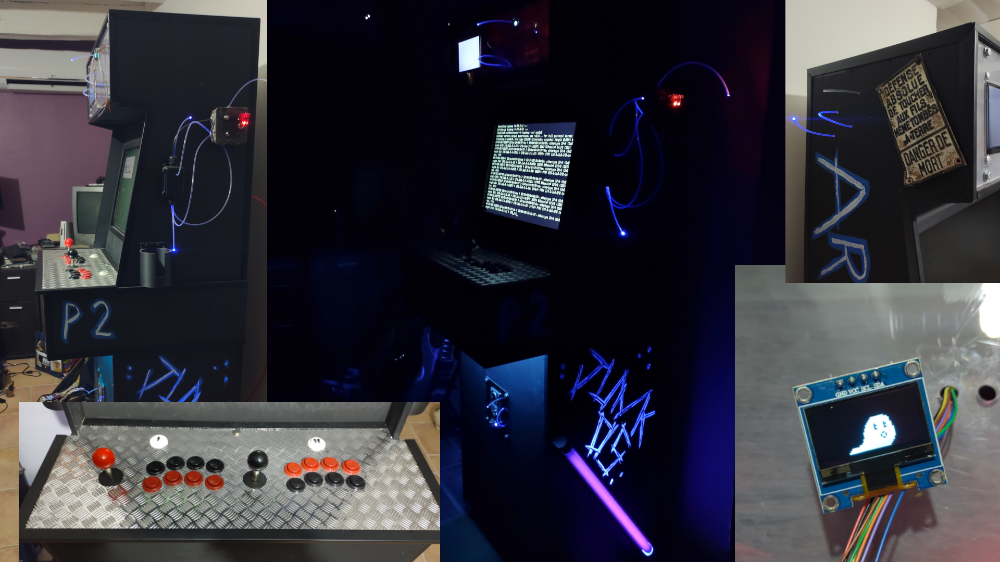
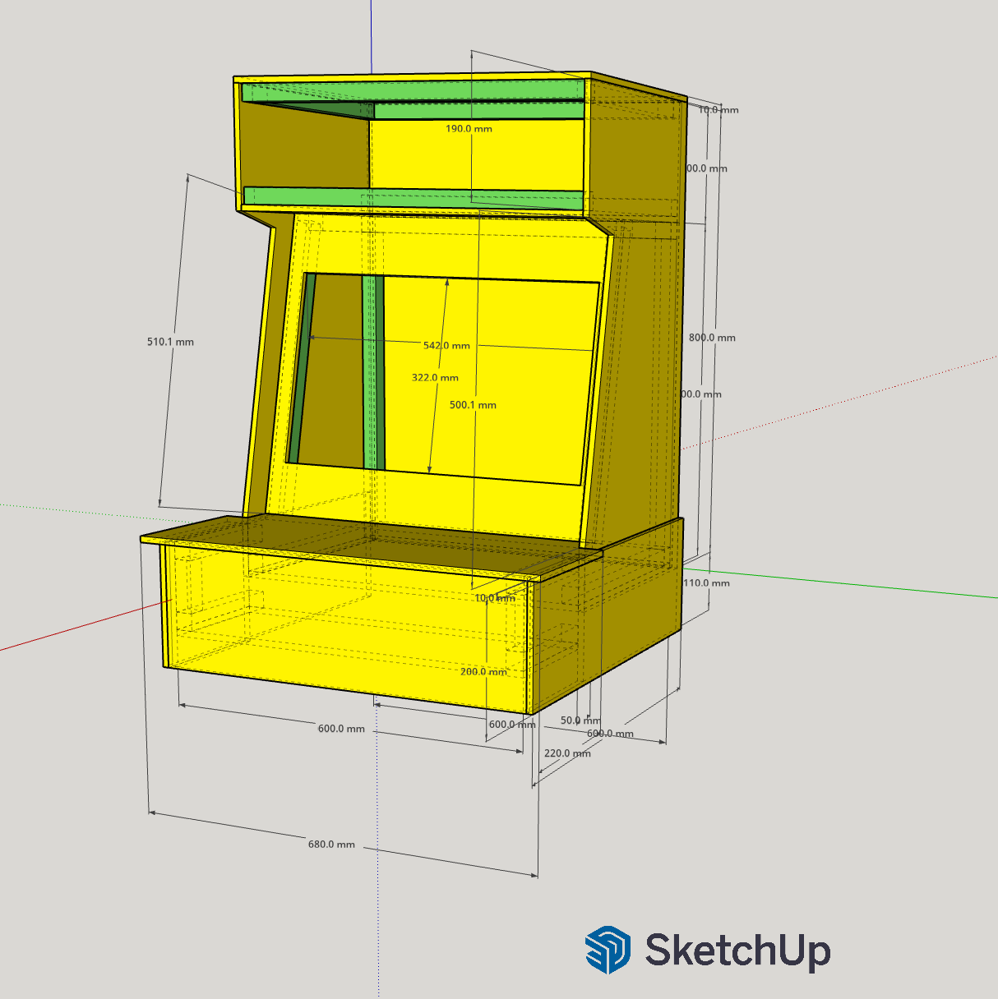
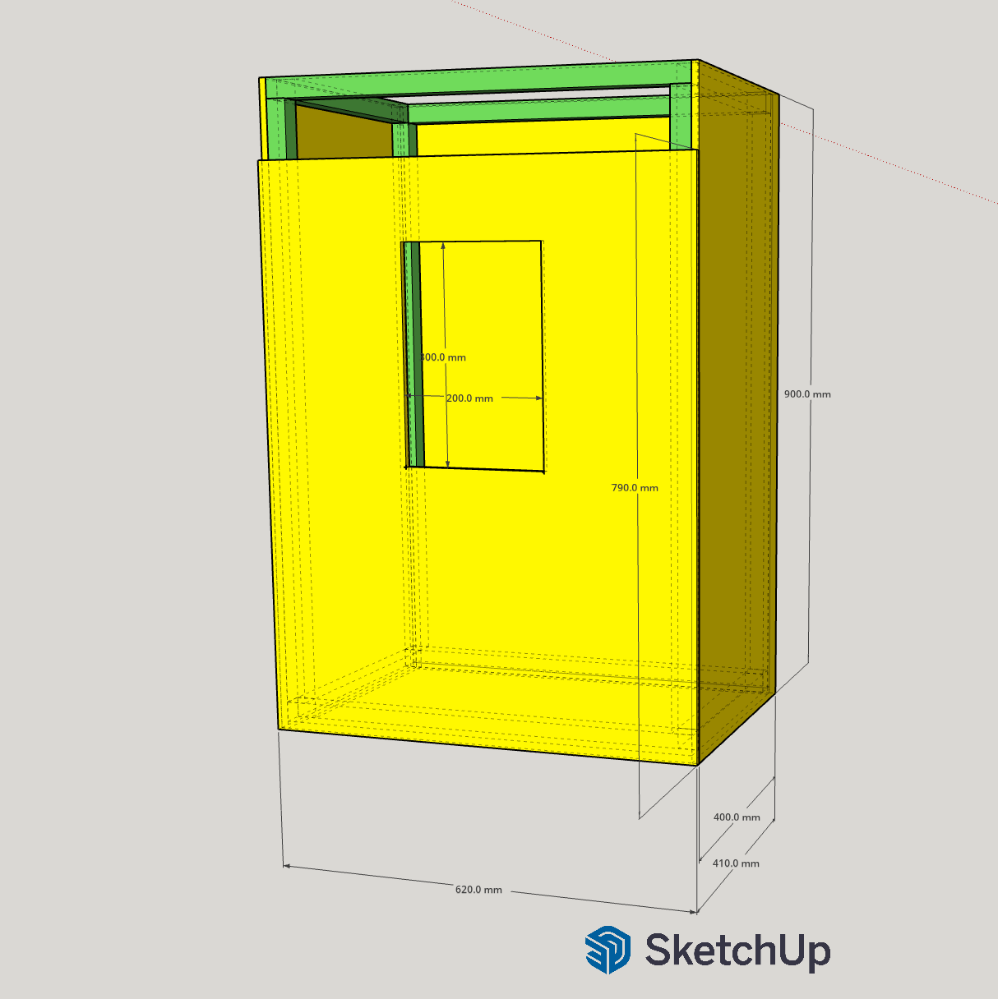

# Arcade3000

Project containing few tools that I created for my arcade cabinet.

Feel free to reuse as it is or to customize it.

## Sketchup

The sketchup project for designing and planning the arcade cabinet. I've used [opencutlist](https://www.lairdubois.fr/logiciels/2-opencutlist.html) plugin so the cutting list can be generated automatically.

## Miniscreen

An Arduino project to display animation on a mini OLED screen (64x128p)

It also handles 3 LEDs which blink/fade randomly.

You can change the animation image (be careful it takes a lot of memory space) or change the number of LEDs.

## Fiberlight

A project to control fiber optic lights / LED for the arcade cabinet. It's just Miniscreen without the screen.

## Junkbox

A jukebox project made with Python and a lot of AI.

More information in its own README file.

## More things... (when I'll have time)

* idle video / animation
* boot animation