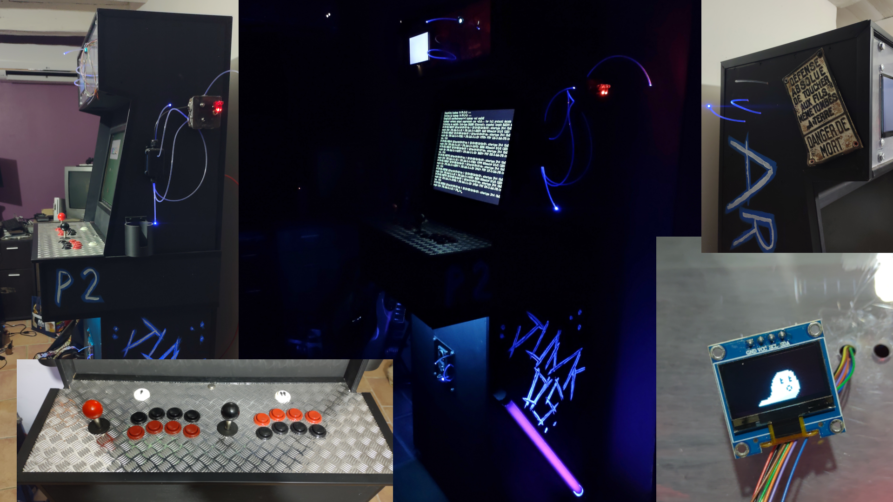
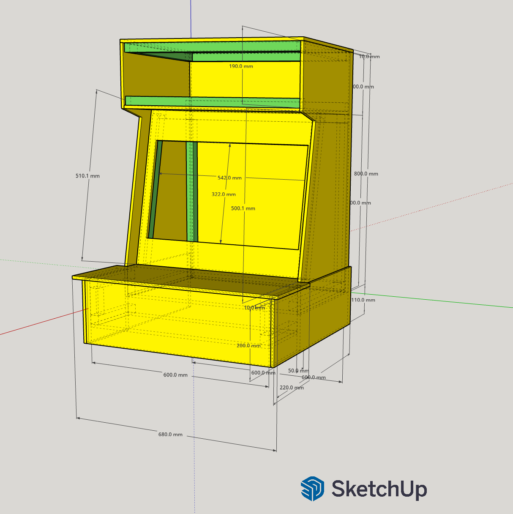
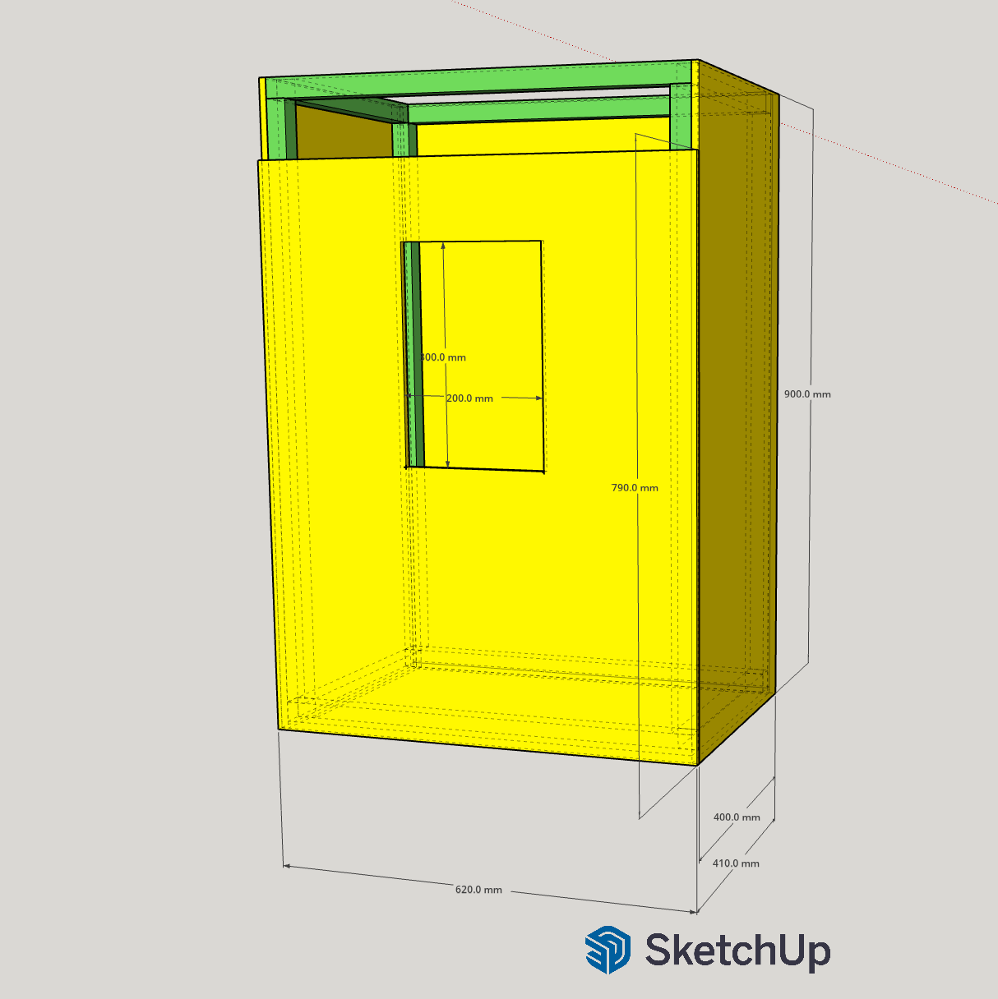

# Arcade3000

Project containing few tools that I created for my arcade cabinet.

Feel free to reuse as it is or to customize it.



## Sketchup

The sketchup project for designing and planning the arcade cabinet. I've used [opencutlist](https://www.lairdubois.fr/logiciels/2-opencutlist.html) plugin so the cutting list can be generated automatically.




## Miniscreen

An Arduino project to display animation on a mini OLED screen (64x128p)

It also handles 3 LEDs which blink/fade randomly.

You can change the animation image (be careful it takes a lot of memory space) or change the number of LEDs.

## Fiberlight

A project to control fiber optic lights / LED for the arcade cabinet. It's just Miniscreen without the screen.

## Junkbox

A jukebox project made with Python and a lot of AI.

More information in its own README file.

## Custom Marquee

The Marquee folder contains images that will be displayed as custom marquees for the arcade cabinet. You have to place the images in `/userdata/system/backglass` folder : 
- console images : `/userdata/system/backglass/systems/<system>/logo.png`
- game images : `/userdata/system/backglass/systems/<system>/games/marquee/<game>.png`
- game video : `/userdata/system/backglass/systems/<system>/games/marquee/<game>-marquee.mp4`

Follow instructions from [Batocera wiki](https://wiki.batocera.org/hardware:lcd_led_marquees)

This folder contain also `Marquee-video.sh`. This script should be palced in the `/userdata/system/scripts` folder (create it if it doesn't exist). This script will be played when a game start and will display the corresponding marquee video if it exists.

Make sure to give execute permission to the script by running:
```bash
chmod +x /userdata/system/scripts/Marquee-video.sh
```
> This script is made for 1920x1080 second screen resolution. If you use different resolution, check the argument of batocera-backglass (ps faux | grep batocera-backglass) then replicate it on the gemetry line onf the script.


## More things... (when I'll have time)

* idle video / animation
* boot animation